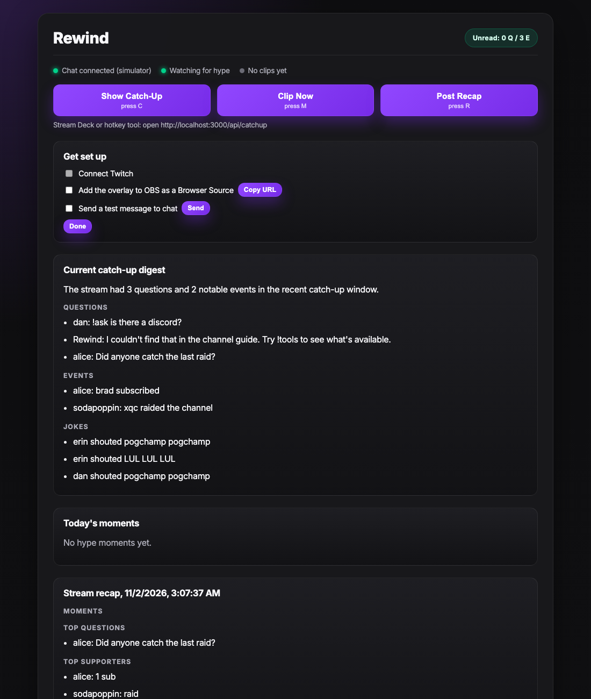
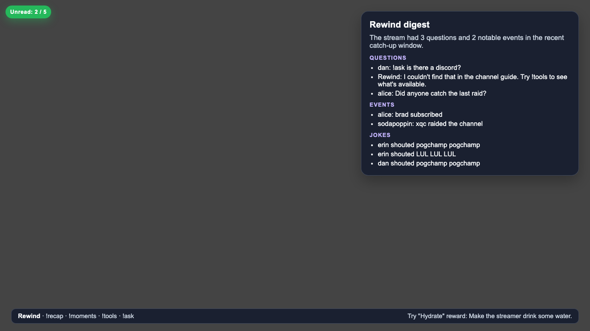

# Rewind

Rewind is a catch-up assistant for Twitch streamers and their viewers. It reads your chat and channel events, then:

- **Catches you up.** One button or `!rewind` turns recent chat into a digest of unanswered questions, events, and jokes.
- **Finds hype moments.** Chat bursts become labeled moments with a clip and a stream marker.
- **Explains your channel.** It learns your commands from bot replies, adds your rewards and extensions, and answers viewers through `!tools` and `!ask`.
- **Helps viewers.** `!recap` tells anyone what they missed, and first-time chatters get a nudge.
- **Recaps the stream.** When you go offline it saves your moments, top questions, top supporters, and any broken tools.




## Setup

You need Node 20+ and a Twitch account.

1. Install dependencies:
   ```sh
   npm install
   cp .env.example .env
   ```
2. Register an app at [dev.twitch.tv/console](https://dev.twitch.tv/console) with client type **Public**, and put its Client ID in `.env` as `TWITCH_CLIENT_ID`.
3. Log in as the streamer account. This prints two tokens to paste into `.env`:
   ```sh
   npm run token
   ```
4. Start Rewind and open the dashboard:
   ```sh
   npm start
   ```
   Then visit `http://localhost:3000/dashboard.html`. Expired tokens refresh automatically and are saved back to `.env`.

### Show it on your stream

| Page | Who sees it | How to add it |
| --- | --- | --- |
| `/overlay.html` | Viewers | OBS → Sources → Browser, 1920×1080 |
| `/popup.html` | Only you | Open in Chrome or Edge, then click **Pop out Rewind**. Keep the tab open. |
| `/dashboard.html` | Only you | Any browser tab |

If OBS uses Display Capture, viewers can see the popup. Use Game Capture or Window Capture, or keep the popup on a second monitor.

### Try it without Twitch

Set `SIMULATE=true` in `.env`. Rewind generates fake chat, bot replies, subs, raids, and emote bursts through the same pipeline as real events. Simulator data is stored in `data/sim-*`, separate from your real channel data.

## Chat commands

| Command | Who | What it does |
| --- | --- | --- |
| `!rewind` | Streamer and mods | Shows the catch-up digest and replies with a recap |
| `!recap` | Everyone | Short "what you missed" reply, once a minute per viewer |
| `!moments` | Everyone | Lists today's hype moments |
| `!tools` | Everyone | Categorized menu of channel tools |
| `!ask <question>` | Everyone | Answers from the channel guide only |
| `!help`, `!commands`, `!rewind help` | Everyone | One-line menu of Rewind commands |

### The channel guide

Rewind learns a command when a known bot (Nightbot, StreamElements, Moobot, Fossabot, Streamlabs, plus any in `BOT_NAMES`) replies within 5 seconds. Commands used 3 or more times with no reply are flagged as possibly broken. `!tools` and `!ask` only mention tools that are confirmed to work.

No chat bot? Add the command on the dashboard and fill in **Rewind reply**, and Rewind answers it itself.

## Hotkeys

On the dashboard, press `C` to show a catch-up, `M` to clip, and `R` to post a recap. For a Stream Deck or a global hotkey tool, open `http://localhost:3000/api/catchup`.

## Configuration

| Variable | Default | Purpose |
| --- | --- | --- |
| `TWITCH_CLIENT_ID` | | Your Twitch app |
| `TWITCH_TOKEN`, `TWITCH_REFRESH_TOKEN` | | Set by `npm run token` |
| `BROADCASTER_ID` | token's account | Only needed if the token isn't the streamer's |
| `OPENAI_API_KEY` | | Enables AI digests and command descriptions. Without it, Rewind uses built-in rules. |
| `OPENAI_MODEL` | `gpt-4o-mini` | Model for AI features |
| `SIMULATE` | `false` | Run with fake chat |
| `BOT_NAMES` | | Extra chat bot accounts, comma separated |
| `ANNOUNCE_INTERVAL_MINUTES` | `0` (off) | How often to post a chat announcement about Rewind |
| `PORT` | `3000` | Local server port |

## Limitations

- Clips and stream markers only work while the channel is live.
- Reward lists require an Affiliate or Partner channel.
- Rewind replies in chat as the streamer's account.
- Run one copy at a time. Refresh tokens are single use, so two copies can log each other out.

## How Codex was used

Rewind was planned as seven milestones, and those milestones were given to Codex to build the project from. Claude Code was also used, for the live Twitch connection fixes, the popup, and finishing the later milestones.

## Development

```sh
npm run dev       # restart on file changes
node --test test/ # run the tests
```
